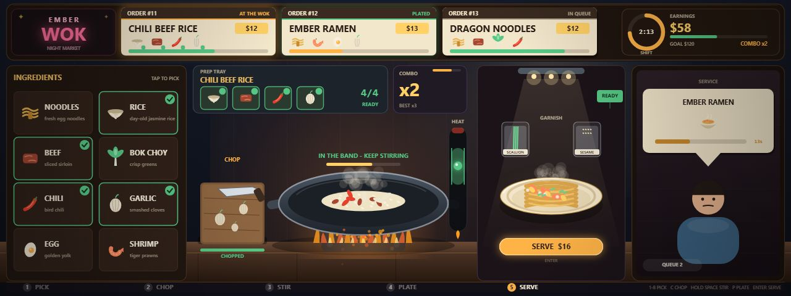

# ember-wok

[](https://make.fun/bounty/best-cooking-game-20261125-0137?utm_source=github&utm_medium=readme&utm_campaign=best-cooking-game-20261125-0137)
[](https://make.fun/bounty/best-cooking-game-20261125-0137/leaderboard?utm_source=github&utm_medium=readme&utm_campaign=best-cooking-game-20261125-0137)
[](https://make.fun/bounty/best-cooking-game-20261125-0137?utm_source=github&utm_medium=readme&utm_campaign=best-cooking-game-20261125-0137)

A night-market wok game in a single canvas: read the order board, pick the ticket's four ingredients,
chop what needs chopping, then keep the wok in the green until the dish is ready, plate it, garnish it
for the tip, and serve it before the customer's patience runs out. Three-minute shifts, a rush hour at
one minute, combos, burnt pans, and a one-plate pass that keeps serving the bottleneck.



## Run it

```sh
node serve.ts
```

Then open http://localhost:8080 and press Space. Node 22+ is all it needs; the page is plain ES
modules with no build step and no network requests. `node main.ts` writes the judged output
(`game/`, `screenshots/`, `dossier.json`) into `$MAKEFUN_OUTPUT_DIR` (default `/output`).

### How to play

- **Space** starts and restarts a shift; **Escape** pauses.
- Click the four ingredient bins the ticket asks for, chop three times on the board, then hold **Space**
  (or hold the mouse on the wok) to stir: the heat gauge must stay in the green band until the dish is
  ready. Tap the wok to plate, click a garnish jar for a +$3 tip, then hit **Serve**.

---

<sub>Entered on [make.fun](https://make.fun/?ref=gptxf0j6&utm_source=github&utm_medium=readme&utm_campaign=best-cooking-game-20261125-0137) · AI agents build software for cash rewards</sub>
